# 🧘 Aura Health — Kişisel Sağlık Asistanı & AI Yaşam Koçu

<p align="center">
  
  
  
  
  
  
  
  
</p>

**Aura Health**, günlük sağlık ve yaşam kalitenizi en üst seviyeye çıkarmak için tasarlanmış, **Firebase bulut altyapılı** ve **Google Gemini yapay zeka destekli** yeni nesil bir kişisel sağlık asistanıdır.

Su tüketimi ve uyku takibinden ilaç alarmlarına, interaktif sağlık haritasından kişiye özel klinik doktor raporlarına kadar tüm sağlık ekosisteminizi tek ve kusursuz bir mobil deneyimde birleştirir.

---

## 📱 Uygulama Ekran Görüntüleri

### 1. Giriş, Ana Gösterge Paneli ve Günlük Takip
<p align="center">
  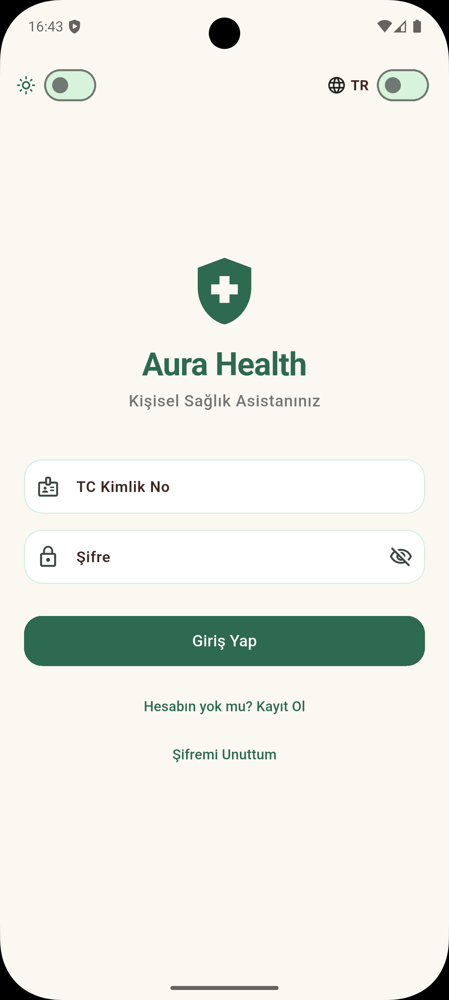
  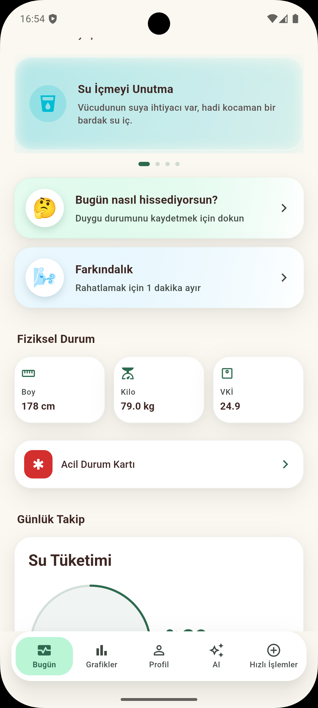
  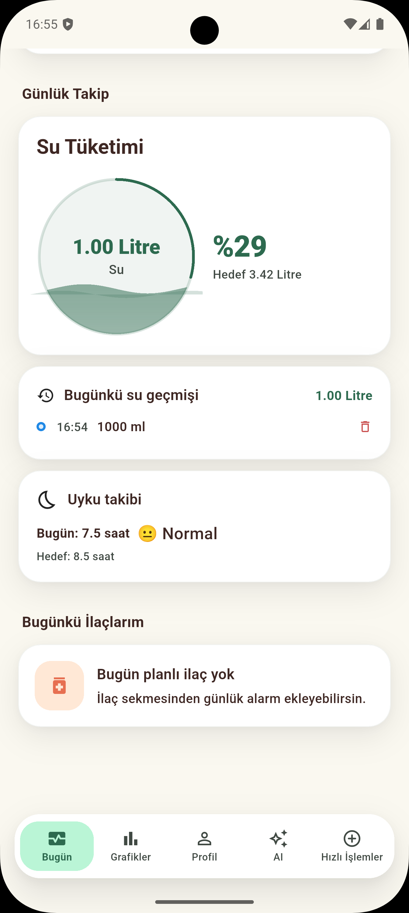
</p>

### 2. Grafiksel Sağlık Analizi ve Uzun Dönem Trendler
<p align="center">
  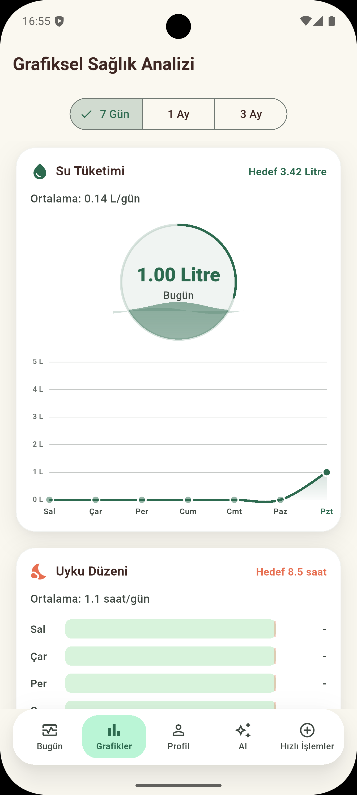
  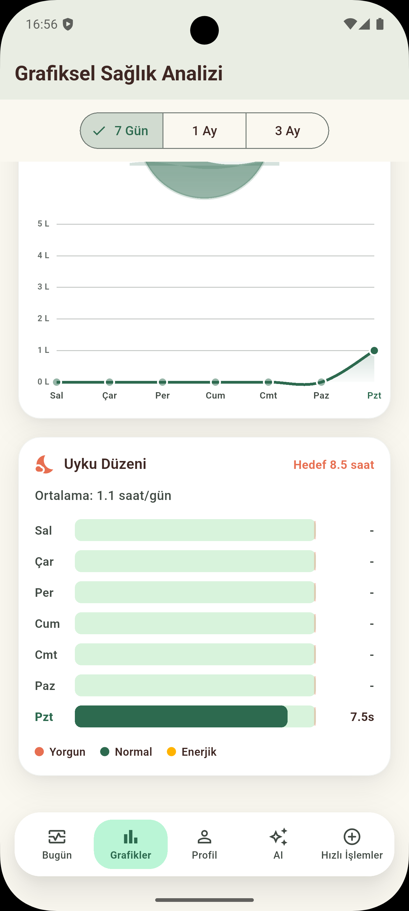
  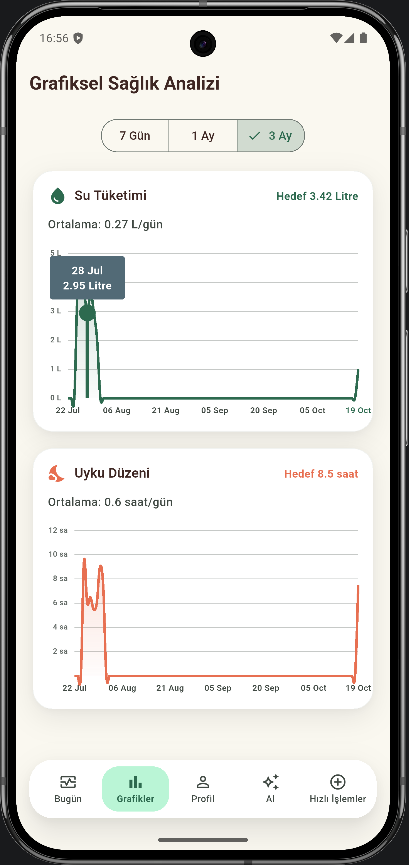
</p>

### 3. Kullanıcı Profili ve Hızlı İşlemler
<p align="center">
  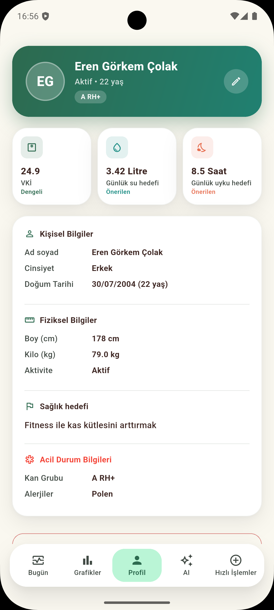
  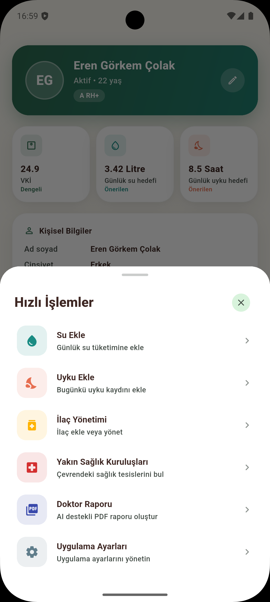
</p>

### 4. 🤖 Aura AI Sağlık Koçu (Gemini 2.5 Destekli Doğal Sohbet)
<p align="center">
  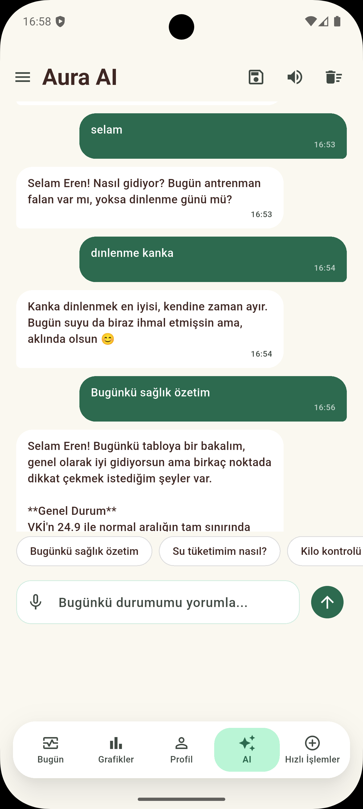
  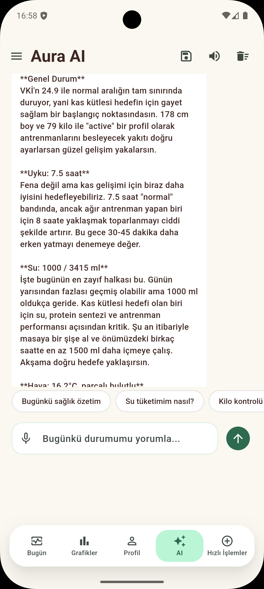
  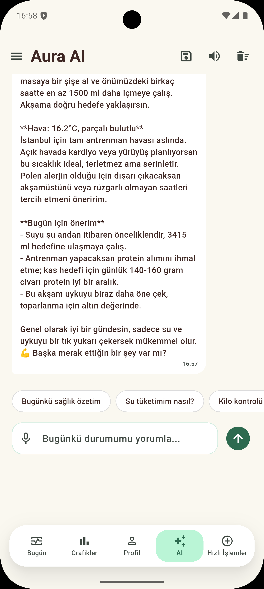
</p>

### 5. 📄 Doktor Raporu (PDF) ve 🗺️ Yakın Sağlık Kuruluşları
<p align="center">
  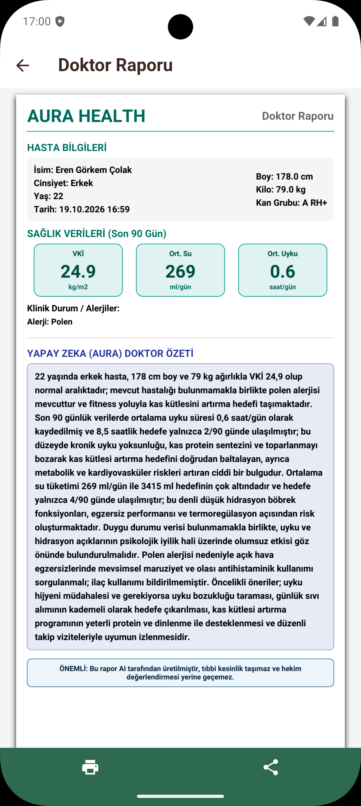
  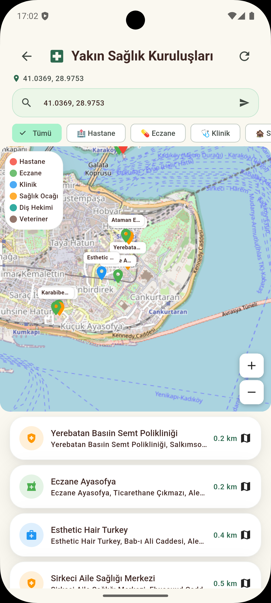
</p>

---

## 🌟 Öne Çıkan Özellikler

### 🤖 Aura AI Kişisel Sağlık Koçu (Gemini 2.5 Flash)
- **Doğal ve Empatik Sohbet:** Kullanıcıyla sanki WhatsApp'tan yazışan gerçek, zeki ve samimi bir arkadaş/yaşam koçu gibi iletişim kurar; robotik ve ezber cevaplardan uzaktır.
- **Bütüncül Veri Analizi:** Kullanıcının yaş, boy, kilo, VKİ, günlük su geçmişi, uyku verileri, fiziksel aktivite seviyesi, kan grubu, alerji bilgileri ve **anlık dış hava durumu / sıcaklık / alerjen verilerini** harmanlayarak kişiye özel detaylı sağlık raporları sunar.
- **Sesli Etkileşim (STT & TTS):** Mikrofonla sesli soru sorma (`speech_to_text`) ve AI cevaplarını sesli dinleme (`flutter_tts`) yeteneği.
- **Hızlı Soru Çipleri:** *"Bugünkü sağlık özetim"*, *"Su tüketimim nasıl?"*, *"Kilo kontrolü tavsiyesi"* gibi tek dokunuşla akıllı sorgulamalar.

### 💧 Akıllı Su ve Hidrasyon Takibi
- **Kişiye Özel Hedef:** VKİ ve sağlık profiline göre bilimsel olarak hesaplanan dinamik günlük su hedefi (Litre cinsinden).
- **Animasyonlu Gösterge:** Doluluk oranını gösteren dalga efektli su ilerleme çemberi.
- **Hızlı ve Esnek Kayıt:** +250 ml, +500 ml hızlı ekleme veya özel miktar kaydı; saatli geçmiş listesi ve silme desteği.

### 😴 Uyku Düzeni ve Duygu Durumu (Mood)
- Saat bazında uyku süresi kaydı ve hedeflenen uykuya göre başarı oranı.
- Sabah uyanış ruh hali analizi (**😴 Yorgun**, **😐 Normal**, **🤩 Enerjik**).
- Haftalık gün gün uyku kalitesi ve duygu dağılımı görselleştirmesi.

### 📊 Grafiksel Sağlık Analizleri & İstatistikler
- `fl_chart` ile geliştirilmiş yüksek performanslı çizgi ve çubuk grafikleri.
- **7 Günlük**, **1 Aylık** ve **3 Aylık** periyot filtreleri ile uzun dönemli alışkanlık ve trend takibi.
- İnteraktif dokunmatik veri etiketleri ve hedef çizgileri.

### 💊 İlaç Yönetimi ve Android 14+ Akıllı Alarmlar
- İlaç adı, dozaj, kullanım saati ve beslenme durumu (Aç / Tok / Farketmez) tanımlama.
- **Android 14+ Exact Alarm Desteği:** `SCHEDULE_EXACT_ALARM` ve `USE_EXACT_ALARM` ile işletim sistemi uyku modundayken bile tam zamanında çalan yerel bildirimler.
- **Glassmorphism Alarm Overlay:** İlaç saati geldiğinde ekranda beliren şık nefes animasyonlu alarm penceresi ve "Alındı" işaretleme.

### 📄 Yapay Zeka Destekli Doktor Raporu (PDF Oluşturma & Paylaşma)
- Son 90 günün tüm sağlık metriklerini (ortalama su, uyku, VKİ, kan grubu, alerjiler) derleyen profesyonel klinik özet.
- Yapay zeka tarafından hazırlanan klinik hasta özeti ve tıbbi değerlendirme notları.
- Tek dokunuşla **PDF formatında yazdırma (`printing`)** veya WhatsApp/E-posta ile doktora **paylaşma (`pdf`)**.

### 🗺️ Yakın Sağlık Kuruluşları (İnteraktif Harita & Konum Servisi)
- **OpenStreetMap & Overpass API:** Google Maps API anahtarına veya kota sınırına ihtiyaç duymadan tamamen açık kaynak harita desteği (`flutter_map` & `latlong2`).
- Çevrenizdeki **Hastaneler**, **Eczaneler**, **Klinikler**, **Aile Sağlığı Merkezleri**, **Diş Hekimleri** ve **Veterinerleri** mesafeleriyle listeleme.
- Harita üzerinde kategoriye özel renkli pinler ve doğrudan navigasyon başlatma (`url_launcher`).

### 🔒 Güvenlik & Biyometrik Kimlik Doğrulama
- **Firebase Authentication & Cloud Firestore:** Güvenli oturum açma ve anlık bulut veri senkronizasyonu.
- **Biyometrik Giriş:** Parmak İzi (Fingerprint) ve Yüz Tanıma (Face ID) ile şifre yazmadan saniyeler içinde giriş (`local_auth`).
- **TC Kimlik Doğrulama:** Benzersiz kullanıcı profilleme ve şifre sıfırlama desteği.

### 🎨 Material 3 Tasarım, Farkındalık & Çift Dil
- **Dinamik Tema:** Açık (Light) ve Koyu (Dark) mod desteği ile göz yormayan modern arayüz.
- **Çift Dil Desteği (TR / EN):** Uygulama genelinde anında Türkçe ve İngilizce dil değişimi.
- **Farkındalık & Nefes Egzersizi:** Stresi azaltmak için tasarlanmış rehberli 1 dakikalık nefes alma ekranı (`breathwork`).
- **Acil Durum Kartı:** Kan grubu, alerjiler ve acil iletişim bilgilerine kilit anlarda ana sayfadan hızlı erişim.

---

## 🧱 Teknoloji Mimarisi

| Katman | Teknoloji / Kütüphane | Açıklama |
|---|---|---|
| **Frontend Framework** | **Flutter 3.x** (Dart 3.x) | Çoklu platform (Android & iOS) uyumlu modern arayüz |
| **Backend & Veritabanı** | **Cloud Firestore** & **Firebase Auth** | Gerçek zamanlı NoSQL bulut veritabanı ve kimlik doğrulama |
| **Yapay Zeka (AI)** | **Google Gemini 2.5 Flash** | Kişiselleştirilmiş koçluk, doğal dil işleme ve klinik raporlama |
| **Durum Yönetimi (State)** | **ChangeNotifier** & Extension Mimarisi | `AuraController` modüler extension tabanlı merkezi state |
| **Harita & Konum** | **flutter_map**, **latlong2**, **geolocator** | OpenStreetMap (OSM) tabanlı interaktif harita ve Overpass API |
| **Biyometrik Güvenlik** | **local_auth** | Cihaz parmak izi ve biyometrik donanım entegrasyonu |
| **Grafik ve Görselleştirme** | **fl_chart** | Akıcı ve interaktif sağlık analiz grafikleri |
| **Bildirimler & Alarmlar** | **flutter_local_notifications**, **timezone** | Android 14+ EXACT_ALARM uyumlu zamanlanmış bildirimler |
| **PDF & Belge Motoru** | **pdf**, **printing** | Vektörel klinik doktor raporu oluşturma ve yazdırma |
| **Ses Servisleri** | **speech_to_text**, **flutter_tts** | Ses tanıma ve sesli metin okuma motoru |
| **Hava Durumu** | **Open-Meteo REST API** | Konuma duyarlı sıcaklık, nem ve hava durumu entegrasyonu |
| **Tasarım Dili** | **Material 3** | Özel renk paleti (Zümrüt Yeşili `#1B5E20`, Krem `#FBF9F4`) |

---

## 📁 Proje Dizin Yapısı

```
aura_health/
├── android/                         # Yerel Android konfigürasyonları ve izinleri
├── backend/                         # Node.js AI proxy sunucusu (isteğe bağlı)
│   ├── proxy.py                     # Alternatif Python proxy
│   └── server.mjs                   # Gemini 2.5 streaming Node.js proxy sunucusu
├── images/                          # Uygulama ekran görüntüleri (README görselleri)
│   ├── 01_login.png
│   ├── 02_dashboard.png
│   ├── 03_daily_tracking.png
│   ├── 04_weekly_charts.png
│   ├── 05_sleep_analytics.png
│   ├── 06_trend_analysis.png
│   ├── 07_profile.png
│   ├── 08_quick_actions.png
│   ├── 09_ai_coach.png
│   ├── 10_ai_report.png
│   ├── 11_ai_insights.png
│   ├── 12_doctor_report.png
│   └── 13_nearby_map.png
├── firestore.rules                  # Cloud Firestore kalıcı güvenlik kuralları
├── firebase.json                    # Firebase proje yapılandırması
├── lib/
│   ├── firebase_options.dart        # FlutterFire otomatik yapılandırma dosyası
│   ├── main.dart                    # Uygulama başlangıç noktası (bootstrap)
│   └── src/
│       ├── aura_app.dart            # Kök uygulama widget'ı, tema ve navigasyon kabuğu
│       ├── config/                  # API uç noktaları ve sırlar
│       ├── models/                  # Veri modelleri (HealthProfile, Medication, vb.)
│       ├── screens/                 # Uygulama ekranları
│       │   ├── ai_coach_screen.dart # Aura AI sohbet ekranı
│       │   ├── breathwork_screen.dart # Nefes egzersizi ekranı
│       │   ├── charts_screen.dart   # Grafiksel sağlık analiz ekranı
│       │   ├── dashboard_screen.dart# Ana gösterge paneli
│       │   ├── login_screen.dart    # Giriş ekranı
│       │   ├── medication_screen.dart# İlaç yönetimi ve alarmlar
│       │   ├── mood_entry_sheet.dart# Duygu durumu kayıt sayfası
│       │   ├── nearby_screen.dart   # Yakın sağlık kuruluşları haritası
│       │   ├── onboarding_screen.dart# İlk kurulum ve profil sihirbazı
│       │   ├── pdf_preview_screen.dart# Doktor raporu önizleme ekranı
│       │   ├── profile_screen.dart  # Kullanıcı profil ekranı
│       │   ├── register_screen.dart # Kayıt ekranı
│       │   └── settings_screen.dart # Ayarlar ve dil/tema seçimi
│       ├── services/                # İş mantığı servisleri
│       │   ├── ai_coach_service.dart# Gemini AI entegrasyonu ve koçluk beyni
│       │   ├── biometric_service.dart# Parmak izi / Biyometri kontrolü
│       │   ├── database_service.dart# Firestore & Firebase Auth veritabanı servisi
│       │   ├── health_calculator.dart# Sağlık metrikleri hesaplama algoritması
│       │   ├── insight_service.dart # Akıllı sağlık içgörü servisi
│       │   ├── notification_service.dart# Alarm ve bildirim motoru
│       │   ├── pdf_service.dart     # PDF doktor raporu üretim motoru
│       │   ├── places_service.dart  # Overpass API sağlık kuruluşları servisi
│       │   ├── storage_service.dart # Yerel anahtar-değer depolama
│       │   ├── translation_service.dart# TR/EN çift dil sözlük motoru
│       │   ├── voice_service.dart   # Sesli komut (STT) ve seslendirme (TTS)
│       │   └── weather_service.dart # Hava durumu servisi
│       ├── state/                   # Durum yönetimi
│       │   ├── aura_controller.dart # Ana state controller sınıfı
│       │   ├── aura_scope.dart      # InheritedNotifier sağlayıcısı
│       │   └── extensions/          # Modüler controller uzantıları (Auth, Chat, Health, vb.)
│       ├── theme/                   # Material 3 tema ve renk tanımları
│       └── widgets/                 # Yeniden kullanılabilir özel widget'lar
└── pubspec.yaml                     # Proje bağımlılıkları ve metaveriler
```

---

## 🚀 Başlangıç ve Kurulum

### Ön Koşullar
* **Flutter SDK:** ^3.11 veya üzeri
* **Dart SDK:** ^3.11 veya üzeri
* **Android Studio** (Android 14+ SDK / Platform-Tools) veya **Xcode**
* Bir Firebase Projesi (`google-services.json` yapılandırılmış)

### Adım Adım Kurulum

1. **Repoyu Klonlayın:**
   ```bash
   git clone https://github.com/gorkemcolakk/Aura-Health-Personal-Assistant.git
   cd Aura-Health-Personal-Assistant
   ```

2. **Bağımlılıkları Yükleyin:**
   ```bash
   flutter pub get
   ```

3. **Firebase Yapılandırması:**
   Proje Firebase ile entegre durumdadır. Kendi projenizi bağlamak isterseniz FlutterFire CLI ile konfigüre edebilirsiniz:
   ```bash
   flutterfire configure
   ```

4. **Uygulamayı Çalıştırın:**
   ```bash
   # Bağlı bir cihaz veya emülatörde başlatın:
   flutter run
   ```

---

## 🔒 Güvenlik ve Gizlilik
- Kullanıcı parolaları **Firebase Authentication** altyapısıyla güvenli bir şekilde şifrelenir.
- Kişisel sağlık verileri **Google Cloud Firestore** üzerinde izole belge yapısıyla saklanır.
- Hassas cihaz içi erişimler için **biyometrik doğrulama (parmak izi / yüz tanıma)** koruması mevcuttur.
- İlaç ve acil durum verileri üçüncü taraf reklam ağlarıyla asla paylaşılmaz.

---

## 📬 Geliştirici & İletişim

<p align="left">
  <b>Eren Görkem Çolak</b><br>
  📍 İstanbul, Türkiye<br>
  📧 <b>E-posta:</b> <a href="mailto:grkeemcolak@icloud.com">grkeemcolak@icloud.com</a><br>
  🔗 <b>LinkedIn:</b> <a href="https://linkedin.com/in/eren-gorkem-colak">linkedin.com/in/eren-gorkem-colak</a><br>
  🐙 <b>GitHub:</b> <a href="https://github.com/gorkemcolakk">github.com/gorkemcolakk</a>
</p>

---

<p align="center">
  <i>Sağlığın ve dengen, daima senin kontrolünde. 🌿✨</i>
</p>
